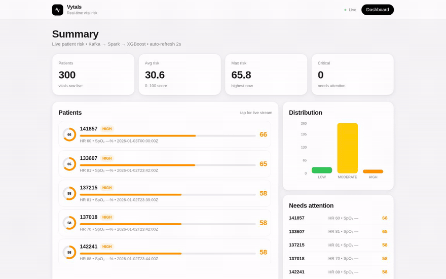

# Vytals — Real-Time Vital Risk Scoring

> 📖 **Docs:** [Presentation pack](docs/PRESENTATION.md) · [Features (non-technical)](docs/FEATURES.md) · [Technical](docs/TECHNICAL.md) · [Progress](docs/PROGRESS.md) · [Installation (Linux/macOS)](docs/INSTALLATION.md)


**Vytals** watches patient vitals (HR, SpO₂, RR, temp, BP) in real time, scores each patient's risk on a single 0–100 number, and streams it to a live dashboard. Built for the course project: *Scalable Big Data Analytics Framework for Real-Time Health-Risk Monitoring Using Multivariate Patient Vital-Sign Data.*



> 🎥 [Full-quality video](docs/demo/demo.mp4) · recorded live with the dashboard backed by **streamed** Postgres scores (`VYTALS_SOURCE=pg`) after a complete Kafka → Spark Structured Streaming → XGBoost → PostgreSQL run on real PhysioNet Challenge 2012 ICU data (300 patients, 28 270 scored windows).

```
Patient vitals
    ↓  (CSV / JSONL replay, key=patient_id, acks=all)
    ↓  raw ICU records also stored in HDFS — hdfs://localhost:9000/user/alvi/vytals/
Kafka topic: vitals.raw  (3 partitions)
    ↓
Spark Structured Streaming
    ├─ JSON parse, schema validate, drop bad timestamps
    ├─ watermark 2 min, event-time, dedupe on (patient_id, event_time, seq)
    ├─ rolling window 5 min / slide 1 min, per patient_id
    ├─ build_features() — shared with training
    └─ XGBoost risk model → Risk 0–100 + LOW/MODERATE/HIGH/CRITICAL
    ↓
PostgreSQL risk_scores  (patient_id, window_end, p_risk, risk_score, risk_level)
    ↓
FastAPI (:8000)  ←→  Next.js dashboard (:3000)
    ├─ /             patient ranking, distribution, critical list
    └─ /patients/[id] live gauges, HR trace, SpO₂+risk, raw stream
```

## Architecture

| Layer | Path | Role |
|---|---|---|
| Source | any CSV/JSONL with vitals cols | `scripts/make_sample_data.py` makes a demo dataset with stable/degrading/critical archetypes; **real data**: `scripts/import_physionet2012.py` imports PhysioNet Challenge 2012 ICU records → `data/vitals_real.csv` |
| Storage | HDFS (single node, Hadoop 3.4.3, JDK 17) | raw Challenge 2012 records + outcomes + pipeline CSVs under `hdfs://localhost:9000/user/alvi/vytals/` — the big-data source of truth; `make hdfs-up` / `hdfs-upload` (`scripts/hdfs.sh`) |
| Loader | `src/vytals/data/loader.py` | CSV/JSONL → canonical schema (`patient_id,event_time,seq,hr,spo2,rr,temp_c,sbp,dbp`); aliases, range clamp (out-of-range→NA, never fabricate), missing allowed |
| Producer | `src/vytals/ingest/producer.py` | replay into `vitals.raw`, Kafka key = `patient_id`, `acks=all`, `--speed 1/60/0` |
| Streaming | `src/vytals/streaming/job.py` | Spark Structured Streaming: parse → validate → watermark 2m → window 5m/1m → features → ML → PG |
| Features | `src/vytals/features/windowed.py` | one `build_features(df)` used by both training (`train.py`) and the stream sink — no duplicated logic. Per vital: current/mean/std/min/max/slope/delta; plus `n_rows, coverage, low_quality` |
| ML | `src/vytals/ml/` | XGBoost regressor (`reg:squarederror`), labels = transparent physiology rules + small noise, grouped-by-patient split (no leakage), top features logged |
| Model artifact | `models/xgb_risk.json` | loaded at API and stream start; falls back to rule-based score if unloadable |
| Store | Postgres `risk_scores` (+ `vitals_raw`) | `src/vytals/store/db.py:ensure()` creates tables; PG runs on host port **5434** (5432/5433 taken by other projects) |
| API | `src/vytals/api/server.py` | FastAPI. Serves either live replay or, when running, can read PG. Endpoints: `/api/health`, `/api/patients`, `/api/patients/{id}/live`, `/api/patients/{id}/history`, `/api/analysis`, `POST /api/advance` |
| Replay sim | `src/vytals/sim/replay.py` | in-memory replay engine so UI works with zero Kafka/Spark running |
| UI | `web/` (Next.js 14, Tailwind, Recharts) | Apple-HIG light theme; `/` dashboard; `/patients/[id]` live route |

## Where data comes from

The project does **not** ship a PhysioNet credentialed dataset (needs access request). Evaluation/demo data is **synthetic**:

```bash
make sample   # writes data/vitals.csv — 12 patients, 180 min, 30s cadence, 3 archetypes
```

| Archetype | Behavior |
|---|---|
| stable (~70%) | normal means, small noise |
| deteriorating (~20%) | HR↑, SpO₂↓, RR↑, temp↑ drift over time |
| critical (~10%) | sustained abnormal |

Point the loader/producer at any real export instead via `--input`. Canonical columns must include patient id, timestamp, and the 6 vitals (missing ok).

### Real data: PhysioNet Challenge 2012 (open access)

The abstract's MIMIC-III plan is **credentialed** (PhysioNet account + CITI training + DUA), so it can't be pulled automatically. The pipeline instead uses the **Challenge 2012** ICU dataset — real monitor/charted vitals for 4000 patients × 48 h, open access, no credentialing:

```bash
make real-data   # imports 300 richest qualifying records -> data/vitals_real.csv
make train-real  # trains -> models/xgb_risk_real.json
```

- Download once into `data/physionet2012/` (raw records kept for HDFS/batch steps):
  `curl -L -o data/physionet2012/set-a.zip https://physionet-open.s3.amazonaws.com/challenge-2012/1.0.0/set-a.zip && unzip -d data/physionet2012 data/physionet2012/set-a.zip`
- Mapping (`scripts/import_physionet2012.py`): HR→`hr`, RespRate→`rr`, Temp→`temp_c`, NISysABP/NIDiasABP→`sbp`/`dbp` (invasive SysABP/DiasABP fallback), **SaO2→`spo2`** — the dataset has no SpO₂ channel; SaO₂ is arterial O₂ saturation, same clinical meaning for hypoxemia.
- Charting is sparse by design (real ICU documentation): HR/BP ~91% present, temp ~60%, SaO₂/RR intermittent — missing stays missing, `coverage`/`low_quality` features flag it.
- `data/physionet2012/Outcomes-a.txt` has real ICU outcomes (SAPS-I, SOFA, LOS, in-hospital death) — kept for model validation against actual mortality.
- Measured on real data (`make train-real`, patient-wise split): **MAE 1.62, R² 0.963**; top features `hr_max`, `sbp_min`, `hr_mean`, `dbp_min` — sane physiology. Windowize on sparse 48 h records takes a few minutes (one-time).
- Run the demo on real data:
  `VYTALS_DATA=data/vitals_real.csv VYTALS_MODEL=models/xgb_risk_real.json make api`

## Where the model comes from

Trained locally by this repo — no external pretrained weights:

```bash
make train    # → models/xgb_risk.json
```

- Features: output of `build_features()` on 5-min tumbling windows per patient (`src/vytals/ml/train.py:windowize`).
- Labels: `RiskModel.rule_score()` — hand-written clinical derangement thresholds, clipped 0–100, plus Gaussian noise σ=2 so the model learns a smooth mapping.
- Split: patient-wise (`GroupShuffleSplit`) so one patient's windows never appear in both train and test.
- Eval: MAE / R² printed; naive R² on random split was inflated — honest patient-wise R² ≈ 0.88 on the demo set. Top features: `spo2_mean`, `sbp_mean`, `temp_c_mean`…

## How to run

### A. Demo — no Kafka, no Java, no Spark

```bash
make install sample train   # venv + sample CSV + train model
make api                    # http://localhost:8000  (replay engine, 2s ticks)
npm --prefix web run dev    # http://localhost:3000
```

Same demo on **real ICU data** (see [Real data](#real-data-physionet-challenge-2012-open-access)):

```bash
make real-data train-real
VYTALS_DATA=data/vitals_real.csv VYTALS_MODEL=models/xgb_risk_real.json make api
```

### B. Full streaming — Kafka + Spark + Postgres

Requires: Docker, Java 11+, `pyspark` installed in the venv (`make install` does it).

```bash
# infra (note: this host's compose v1 is broken; use docker run)
docker run -d --name vytal-zk   -p 2181:2181 -e ZOOKEEPER_CLIENT_PORT=2181 -e ZOOKEEPER_TICK_TIME=2000 confluentinc/cp-zookeeper:7.5.0
docker network create vytal-net 2>/dev/null
docker run -d --name vytal-kafka --network vytal-net -p 9092:9092 --hostname kafka \
  -e KAFKA_BROKER_ID=1 -e KAFKA_ZOOKEEPER_CONNECT=vytal-zk:2181 \
  -e KAFKA_ADVERTISED_LISTENERS=PLAINTEXT://kafka:29092,PLAINTEXT_HOST://localhost:9092 \
  -e KAFKA_LISTENER_SECURITY_PROTOCOL_MAP=PLAINTEXT:PLAINTEXT,PLAINTEXT_HOST:PLAINTEXT \
  -e KAFKA_INTER_BROKER_LISTENER_NAME=PLAINTEXT \
  -e KAFKA_OFFSETS_TOPIC_REPLICATION_FACTOR=1 \
  -e KAFKA_AUTO_CREATE_TOPICS_ENABLE=true confluentinc/cp-kafka:7.5.0
docker run -d --name vytal-postgres -p 5434:5432 \
  -e POSTGRES_DB=vytals -e POSTGRES_USER=vytals -e POSTGRES_PASSWORD=vytals postgres:16

make db          # create tables in PG on :5434
make producer    # CSV → vitals.raw @ 60×
make stream      # Spark → risk_scores
make api         # API + UI (replay mode — in-memory demo source)
VYTALS_SOURCE=pg make api   # API + UI backed by the STREAM's scores in PG
```

### C. HDFS — distributed storage of the raw dataset

```bash
make hdfs-up        # format (first run) + start NameNode/DataNode on :9000
make hdfs-upload    # 4000 Challenge 2012 records + outcomes + CSVs → HDFS
make hdfs-status    # cluster report
```

Spark reads the raw data straight from `hdfs://localhost:9000/user/alvi/vytals/…`; details in [TECHNICAL §14](docs/TECHNICAL.md).

### D. Batch analytics — MapReduce + Spark SQL + ML experiments

Needs `make hdfs-up` + `make hdfs-upload` first (Spark/`compare`/`shap` also use the local `data/cache/` window cache, rebuilt on first run):

```bash
make mr       # objective 4  — MapReduce on YARN: abnormal-event frequency over 1.76M readings (15 s)
make batch    # objectives 10/11 — Spark SQL descriptive + diagnostic analytics over HDFS
make compare  # objective 13 — LR/RF/XGBoost/IsolationForest, patient-wise CV table
make shap     # objective 14 — SHAP global + local plots → docs/screenshots/
make bench    # objective 17 — pandas vs Spark timing on the same 1.76M-row batch
make validate # outcome validation — streamed scores vs real ICU mortality (AUROC 0.715)
```

Measured highlights (full tables in [TECHNICAL §16–20](docs/TECHNICAL.md)): XGBoost wins the model race (F1 0.882 vs RF 0.775 / LR 0.168); SHAP ranks `hr_max`, `temp`, `sbp` on top (sane physiology); pandas beats single-node Spark 60.9× at this scale — reported honestly, the distributed win needs multi-node data.

### CI/CD

`.github/workflows/ci.yml` on every push/PR:
- backend: install, py_compile, sample data, loader, train, predict, API smoke (`/api/health`, `/api/patients`, `/api/analysis`)
- frontend: `npm ci`, `tsc --noEmit`, `next build`

## Config

`config/default.yaml`:

```yaml
kafka:     bootstrap_servers: localhost:9092, topic: vitals.raw, partitions: 3, acks: all
streaming: watermark: "2 minutes", window: "5 minutes", slide: "1 minute"
postgres:  host: localhost, port: 5434, db: vytals, user: vytals, password: vytals
model:     path: models/xgb_risk.json, version: v1
```

## Honest limitations

- Risk "truth" is rule-based labels + noise — a demo stand-in for a clinically validated target. External check: streamed scores reach death AUROC 0.715 vs real `Outcomes-a.txt` without ever seeing a death label.
- API runs two modes: default **replay** (in-memory, zero infra) or **`VYTALS_SOURCE=pg`** (dashboard reads the streamed scores from PG, vitals as-of-joined from the replayed CSV).
- Streaming sink approximates slope/delta as 0 and current≈window mean; training uses full trailing windows. Feature impl is shared via `build_features()` to avoid drift, but the Spark mini-window is coarser than batch.
- Legacy `docker-compose` v1 on this host breaks against Docker 29 — use `docker run` or upgrade to the compose plugin.
- Port map on this host: 5432 = system pg, 5433 = care stack, **5434 = vytals pg**, 9092 = vytals kafka.
