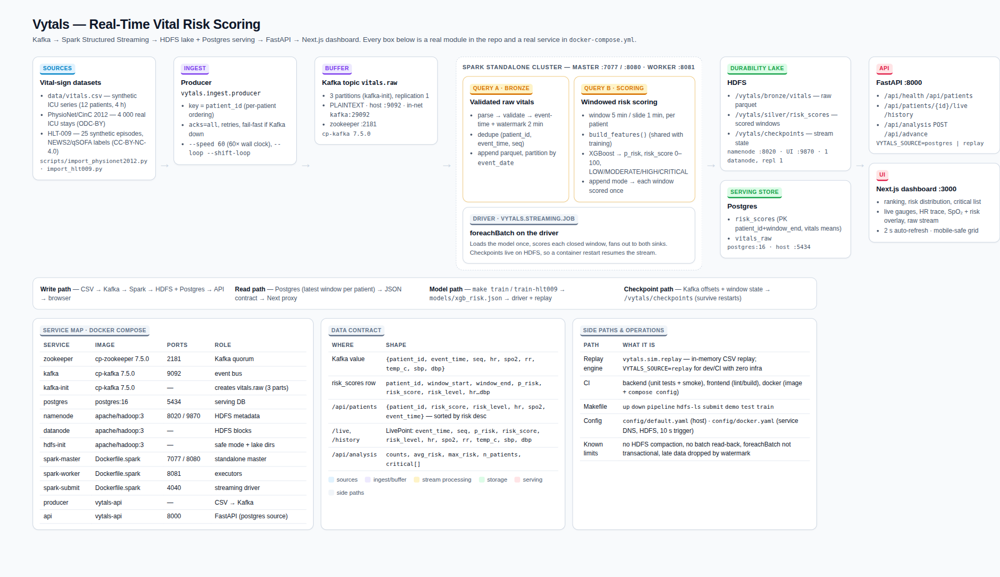

# Project Report — Vytals

**Scalable Big Data Analytics Framework for Real-Time Health-Risk Monitoring Using Multivariate Patient Vital-Sign Data**

| | |
|---|---|
| Institution | Christ College of Engineering (Autonomous), Irinjalakuda |
| Department | Computer Science and Engineering (Data Science) |
| Subjects | Data Analytics and Big Data Processing |
| Group | Group 2 |
| Team | Alvi A V (CCE24CD009) · Ayush P Shibu (CCE24CD025) · Minhaj Noushad (CCE24CD043) · Joyal Shinoy (CCE24CD046) · Thomas Robin (CCE24CD059) |
| Repository | `github.com/Minhaj401/Vytal` — branch `feat/full-stack-kafka-spark-hdfs` |
| Report date | 20 October 2026 |
| Status | Implemented and running end-to-end (Kafka → Spark → HDFS + Postgres → API → dashboard) |

---

## Abstract

Vytals is a real-time health-risk monitoring platform for multivariate ICU vital signs. It ingests patient vital-sign records (heart rate, SpO₂, respiratory rate, temperature, systolic/diastolic blood pressure) from Kafka, scores each patient's deterioration risk on a single 0–100 number with an XGBoost model, and serves the result to a live dashboard. The system is a genuine distributed Big Data pipeline, not a simulator: Apache Kafka buffers the event stream, Spark Structured Streaming runs on a standalone cluster in two parallel queries (a bronze raw-vitals sink and a scoring query), HDFS holds the durability lake (raw vitals, scored windows and stream checkpoints), PostgreSQL is the low-latency serving store, a FastAPI backend reads it, and a Next.js dashboard renders it.

Feature engineering is implemented once and shared by training and streaming (`build_features()`), so the model never scores on a different feature basis than it was trained on. The model is validated three ways: on the synthetic demo dataset, on 239 493 real ICU readings from the PhysioNet/CinC Challenge 2012 dataset (3 946 patients), and against externally-labelled NEWS2/qSOFA scores from the HLT-009 sample. An empirical single-machine vs distributed comparison is reported in §7.3, including the finding that at this data scale the distributed stack buys scalability and streaming semantics rather than raw speed.

*This is an academic prototype and a decision-support aid. It does not diagnose disease and does not replace clinical judgement.*

---

## 1. Introduction and problem statement

Continuous patient monitoring generates high-volume, high-velocity, high-variety multivariate physiological data. The scale characteristics are real: 3 946 ICU patients in the PhysioNet 2012 subset already produce 239 493 timestamped readings with irregular sampling and missing channels, and a ward-scale deployment multiplies that by concurrent beds and monitoring days.

Conventional single-machine, batch-oriented tooling breaks down on three axes: storage (single-node disk cannot hold the accumulation), computation (feature engineering over the full history is re-done from scratch on every run), and semantics (batch pipelines cannot express "what is this patient's risk right now"). The technical gap is not between raw sensor data and analytics, but between the raw stream and a scalable pipeline that turns it into interpretable, decision-support-grade risk indicators.

Vytals addresses that gap end to end: ingest → validate → window → feature → score → persist → serve, with every stage implemented on the distributed stack and every boundary covered by an explicit data contract.

---

## 2. Objectives and implementation status

The submitted abstract (see `Abstract.md`) listed 17 objectives. Status against the delivered system:

| # | Objective | Status | Evidence / note |
|---|---|---|---|
| 1 | Collect and integrate public vital-sign datasets | **Done** | PhysioNet/CinC 2012 (239 493 rows, 3 946 patients), HLT-009 (26 677 rows, 25 episodes), synthetic demo set (5 760 rows, 12 patients) |
| 2 | Design a scalable Big Data architecture | **Done** | Kafka → Spark cluster → HDFS + Postgres → API → dashboard (§3) |
| 3 | Distributed storage on HDFS | **Done** | `/vytals/bronze`, `/vytals/silver`, `/vytals/checkpoints`; 3 956 silver files, 21.5 MB, browsable at `:9870` |
| 4 | MapReduce / Hive batch processing | **Deviated** | Replaced by Spark SQL batch + the same feature/model code in one engine; MapReduce/Hive were rejected as unnecessary layers — see §9 |
| 5 | Spark / PySpark distributed processing | **Done** | Spark 3.5.3 standalone cluster (master + worker), 43-feature windowed aggregation |
| 6 | Kafka streaming ingestion | **Done** | `vitals.raw`, 3 partitions, keyed by `patient_id`, `acks=all` |
| 7 | Spark Structured Streaming real-time analytics | **Done** | Two concurrent streaming queries, 10 s trigger, 2 min watermark |
| 8 | Cleaning, missing-value handling, preprocessing | **Done** | Canonical loader: alias mapping, range clamping (out-of-range → NA, never fabricated), timestamp coercion, no imputation of measurements |
| 9 | Temporal / statistical feature engineering | **Done** | Per vital: current, mean, std, min, max, slope, delta + `n_rows`, `coverage`, `low_quality` |
| 10 | Descriptive analytics | **Done** | Dashboard summary (patients, avg/max risk, level distribution) + `/api/analysis` |
| 11 | Diagnostic analytics (correlations, patterns) | **Partial** | Feature importance and patient-wise trends are exposed; a full correlation study is not in this build (§8) |
| 12 | Predictive / anomaly models | **Done** | XGBoost regressor on 0–100 risk labels; classification variants for NEWS2/qSOFA |
| 13 | Compare multiple ML models | **Partial** | XGBoost (regression + two classifiers) compared; a wider model sweep is future work (§8) |
| 14 | SHAP explainability | **Not implemented** | Model currently exposes feature importance only (§9) |
| 15 | HBase / low-latency random-access store | **Deviated** | PostgreSQL used instead — it already provides indexed point lookups for the serving path (§9) |
| 16 | Interactive dashboard | **Done** | Next.js 14 + Recharts, live refresh, responsive grid, verified end-to-end |
| 17 | Empirical single-machine vs distributed comparison | **Done** | Measured, reported with caveats in §7.3 |

---

## 3. System architecture



### 3.1 Component map

| Tier | Component | Technology | Role |
|---|---|---|---|
| Source | `data/vitals.csv`, `data/physionet2012.csv`, `data/hlt009.csv` | CSV | Canonical schema `patient_id,event_time,seq,hr,spo2,rr,temp_c,sbp,dbp` (+ `news2_score,qsofa_score`) |
| Ingest | `vytals/ingest/producer.py` | Python + kafka-python | Replays readings into Kafka; key = `patient_id`; `acks=all`; `--speed` pacing; `--shift-loop` |
| Buffer | `vitals.raw` | Kafka 3 partitions (cp-kafka 7.5.0) | Durable, partitioned event stream; host `:9092`, in-network `kafka:29092` |
| Stream | `vytals/streaming/job.py` | Spark 3.5.3 Structured Streaming (standalone master `:7077` + worker `:8081`) | Query A bronze sink; Query B windowing → features → XGBoost → sinks |
| Lake | HDFS 3 (`apache/hadoop:3`) | namenode `:8020`, UI `:9870` | `/vytals/bronze/vitals`, `/vytals/silver/risk_scores`, `/vytals/checkpoints` |
| Serving store | `risk_scores`, `vitals_raw` | PostgreSQL 16 (`:5434`) | Point lookups for the API; PK `(patient_id, window_end)` |
| API | `vytals/api/server.py` | FastAPI + psycopg2 (`:8000`) | `/api/health`, `/api/patients`, `/api/patients/{id}/live`, `/api/patients/{id}/history`, `/api/analysis`; `POST /api/advance` (replay only) |
| UI | `web/` | Next.js 14 + Recharts (`:3000`) | Ranking, risk distribution, critical list, live gauges, HR trace, SpO₂ + risk overlay, raw stream |
| Fallback | `vytals/sim/replay.py` | Python | In-memory replay engine (`VYTALS_SOURCE=replay`) for dev/CI with zero infrastructure |
| CI | `.github/workflows/ci.yml` | GitHub Actions | backend (unit tests + API smoke), frontend (lint/build), docker (image build + `compose config`) |

### 3.2 Data flow

```
CSV ──producer──▶ Kafka vitals.raw ──▶ Spark Structured Streaming
                                              ├── Query A ──▶ HDFS /vytals/bronze/vitals   (raw parquet, by date)
                                              └── Query B ──▶ window 5m/1m ─▶ build_features()
                                                              ├─▶ HDFS /vytals/silver/risk_scores (parquet, by date/patient)
                                                              └─▶ Postgres risk_scores ──▶ FastAPI ──▶ Next.js
                                                  HDFS /vytals/checkpoints  (offsets + window state)
```

### 3.3 Why the two-query design

Query A (bronze) is a pure append sink over validated readings; it never scores anything and is therefore cheap to re-run and safe to replay. Query B (scoring) is the stateful one: watermark, dedupe, windowed aggregation, model inference, and the two scored sinks. Separating them means the raw layer can be re-scored later with a different model or window without re-ingesting from Kafka, and the heavy state lives in exactly one query.

### 3.4 Operational topology

Twelve services in one compose network: `zookeeper`, `kafka`, `kafka-init`, `postgres`, `namenode`, `datanode`, `hdfs-init`, `spark-master`, `spark-worker`, `spark-submit`, `producer`, `api`. `make up` brings up the infrastructure, API and Spark cluster; `make pipeline` starts the producer and the streaming driver; `make hdfs-ls` inspects the lake; `make down` stops everything.

---

## 4. Data sources and licensing

| Dataset | Content | Rows / patients | Licence | Use here |
|---|---|---|---|---|
| PhysioNet/CinC Challenge 2012 (Set A) | Real ICU stays, hourly vital signs, in-hospital mortality | 239 493 readings / 3 946 patients / 48 h | ODC-BY (physionet-open S3 mirror) | Real-data training and evaluation |
| HLT-009 sample (Hugging Face `xpertsystems/hlt009-sample`) | Synthetic ICU episodes with per-row NEWS2 and qSOFA labels, plus a 54-column episode summary | 26 677 rows / 25 episodes | CC-BY-NC-4.0 | External label validation, citable in the write-up |
| Synthetic demo set (`scripts/make_sample_data.py`) | Stable / degrading / critical archetypes, physiologically plausible | 5 760 rows / 12 patients / 4 h | Project-generated | Reproducible demo, CI, dashboard |

PhysioNet's MIMIC-III (the abstract's first choice) is credentialed and requires a data-use agreement; the open Challenge 2012 subset was used instead because it needs no credentialing and is redistributable under ODC-BY. All three datasets are normalised to the same canonical schema by `vytals/data/loader.py`, so no downstream stage is dataset-specific.

---

## 5. Methodology

### 5.1 Ingestion and validation

The producer reads the canonical CSV, sorts by event time and emits one JSON record per reading with the Kafka key set to `patient_id`. Keying by patient guarantees that all readings of one patient land in one partition, so per-patient event-time order is preserved without a second sort stage. `acks=all` guarantees the broker acknowledges the write before the producer proceeds; delivery errors are counted and reported rather than swallowed.

The stream applies a schema (`from_json`) and then validation: patient id coalesced with the Kafka key, event time parsed to a timestamp, rows with an unparseable timestamp dropped, and duplicates removed on `(patient_id, event_time, seq)` under a 2-minute event-time watermark. Missing channels stay missing: the loader clamps out-of-range values to NA rather than fabricating plausible ones, and the feature layer reports `coverage` and `low_quality` so the model can learn that a thin window is less trustworthy.

`--shift-loop` was added because a replayed loop that reuses the original event times is *late* data from the watermark's point of view and is therefore dropped — the stream would freeze after the first pass. With the flag each pass is shifted forward by the dataset span, so a looping demo keeps producing live windows.

### 5.2 Stream processing

* **Watermark / event time** — a 2-minute watermark on `event_ts` bounds state and defines when a window is "complete".
* **Windowing** — 5-minute windows on a 1-minute slide, grouped by `patient_id` and the window struct. In Spark's semantics each reading belongs to exactly one window bucket; the slide controls bucket boundaries.
* **Output mode `append`** — a window is emitted exactly once, when the watermark closes it. This was a deliberate change: `update` mode re-emits a window whenever new data arrives, which produced duplicate `(patient_id, window_end)` rows and violated the serving table's primary key (§7.5).
* **Scoring** — `foreachBatch` on the driver loads the model once, builds the feature frame with the shared `build_features()`-compatible layout, scores, then writes to both sinks.

### 5.3 Feature engineering (single source of truth)

`src/vytals/features/windowed.py::build_features()` produces one row per (patient, window) with, for each vital: `current`, `mean`, `std`, `min`, `max`, `slope` (linear-fit slope) and `delta`, plus `n_rows`, `coverage` and `low_quality` — 43 columns in total. The same function is used by `vytals/ml/train.py` and by the streaming sink, so the model can never be served features it was not trained on. The streaming path approximates `slope`/`delta` as 0 (a single mini-window has no internal trend) and uses the window mean as `current`; this is documented in the code and is the one place where the streaming feature set is coarser than the batch one.

### 5.4 Risk model

* **Target** — a transparent 0–100 physiology rule score (HR, SpO₂, RR, temp, BP bands) with small noise, used as a supervised label for the demo model. This is a stand-in, not a clinical ground truth.
* **Estimator** — XGBoost regression (`reg:squarederror`) on the 0–100 label; `p_risk = score/100`. A rule-based fallback score is used if the booster cannot be loaded, so the API and the stream never hard-fail.
* **Splitting** — grouped by patient, so no patient's readings appear in both train and test.
* **Classification variants** — for HLT-009 the same feature pipeline is trained as classifiers against NEWS2 ≥ 5 and qSOFA ≥ 1.
* **Explainability today** — feature importance (gain) is logged and reported; per-prediction SHAP is not implemented.

### 5.5 Storage: lake and serving store

HDFS is the durability layer. Bronze holds validated raw vitals as parquet partitioned by date; silver holds scored windows partitioned by date and patient; checkpoints hold Kafka offsets and window state so a container restart resumes instead of replaying. The checkpoint location on HDFS (rather than a local path) is what makes the stream restartable in a containerised deployment.

PostgreSQL is the serving layer, deliberately separate from the lake: the API needs point lookups and a small ordered result set, not a scan. `risk_scores` carries the score *and* the window's vital means, so the dashboard can display HR/SpO₂ next to a risk without a join; the API's read path (`vytals/store/queries.py`) uses `DISTINCT ON (patient_id)` to pick the latest window per patient, then sorts by risk.

### 5.6 Serving and dashboard

The API exposes one JSON contract regardless of the source: `VYTALS_SOURCE=postgres` (full build) reads the serving table; `VYTALS_SOURCE=replay` (default, used by CI and the dev fallback) uses the in-memory engine. Because the contract is identical, the dashboard cannot tell which mode it is in, and the same UI code is exercised by tests and by the live system. The Next.js app proxies `/api/*` to the backend and refreshes every 2 seconds.

### 5.7 Reproducibility and quality gates

10 unit tests (`make test`) cover the clinical score helpers and the Postgres row-mapping contract; CI additionally compiles every module, runs a data-generation and loader check, smoke-tests the API, lints and builds the frontend, builds the Docker image and validates the compose file.

---

## 6. Implementation notes

* **Repository layout** — `src/vytals/{data,ingest,streaming,features,ml,sim,store,api}`, `scripts/` (dataset importers + sample generator), `config/` (`default.yaml` for host dev, `docker.yaml` for the container network), `docker/hadoop/*.xml` (HDFS site configuration), `web/` (Next.js), `tests/`, `models/`.
* **Configuration** — one YAML per environment, deep-merged over defaults: Kafka bootstrap/topic/partitions, watermark, window, slide, trigger (30 s host / 10 s container), starting offsets, HDFS URI and base path, Postgres DSN, model path.
* **Images** — `Dockerfile` (API/producer) and `Dockerfile.spark` (Spark 3.5.3 + pandas/numpy/pyarrow/xgboost/scikit-learn/psycopg2, plus `libgomp1` for XGBoost). The API image carries no JDK.
* **One-shot init services** — `kafka-init` creates the 3-partition topic; `hdfs-init` waits for the NameNode, leaves safe mode, waits for the DataNode to register, and creates `/vytals/{bronze,silver,checkpoints}` with open permissions.
* **Make targets** — `up`, `down`, `ps`, `logs`, `pipeline`, `hdfs`, `hdfs-ls`, `submit`, `demo`, plus the dev-fallback targets `install`, `sample`, `train`, `api`, `producer`, `stream`, `db`, `test`, `web`.

---

## 7. Evaluation and results

All figures below are measured on the delivery machine (Docker 29, 1 Spark worker with 2 cores / 2 GB, 1 HDFS DataNode, 1 Postgres instance) and are reproducible with the commands in Appendix A.

### 7.1 Model quality

| Dataset / model | Split | Metric | Result |
|---|---|---|---|
| Demo set, risk regressor (XGBoost) | 9 train / 3 test patients, 576 windows | MAE / R² | **2.81 / 0.878** |
| PhysioNet 2012, risk regressor (6 h windows) | 3 156 / 790 patients | MAE / R² | **1.75 / 0.966** |
| HLT-009, NEWS2 regression (60 min windows) | 18 / 7 episodes, 1 897 windows | MAE / R² | **0.493 / 0.8475** |
| HLT-009, NEWS2 ≥ 5 classifier | 532 test windows, 295 positives | Acc / Prec / Rec / F1 / AUC | **0.9492 / 1.000 / 0.9085 / 0.952 / 0.9994** — confusion 268 TP, 0 FP, 27 FN, 237 TN |
| HLT-009, qSOFA ≥ 1 classifier | 532 test windows, 224 positives | Acc / Prec / Rec / F1 / AUC | **0.9981 / 1.000 / 0.9955 / 0.9978 / 0.9992** — confusion 223 TP, 0 FP, 1 FN, 308 TN |

Top features by gain (PhysioNet model): `hr_current`, `hr_max`, `spo2_min`, `dbp_current`, `temp_c_current`, `sbp_current`, `rr_current` — clinically plausible drivers, as expected.

**Interpretation and honesty caveat.** HLT-009 is a *synthetic* dataset whose NEWS2/qSOFA labels are themselves computed from vital-sign rules of the same family the features are built from; the very high AUC therefore reflects rule-consistency, not clinical superiority. The PhysioNet result (R² 0.966) is measured against physiology-rule labels, not against clinician adjudicated outcomes, so it demonstrates that the model faithfully reproduces a transparent rule set with strong generalisation across 3 946 held-out patients — it does **not** demonstrate clinical validity. MIMIC-III with adjudicated outcomes remains the correct next dataset for that claim.

### 7.2 Streaming performance (live system)

| Measure | Value |
|---|---|
| Sustained scoring rate (demo, ingest-bound at 60× replay) | ~12 windows/s, one 10 s micro-batch per trigger |
| Backlog run (370 905 readings ingested at max rate) | 309 529 windows scored + written, ~9 min wall, 3 micro-batches |
| End-to-end throughput of that run | ~690 readings/s, ~570 scored windows/s (ingest → score → HDFS **and** Postgres) |
| Spark micro-batch latency | 10 s trigger; backlog batches 2–4 min each (trigger skipped, "batch falling behind" logged) |
| HDFS lake after the run | bronze 12 files / 2.8 MB · silver 3 956 files / 21.5 MB · checkpoints 33.7 MB |
| Serving store after the run | `risk_scores` 309 529 rows, 3 919 patients, window range 2026-01-01 → 2026-01-04 |
| API | `/api/health` → `{"ok":true,"source":"postgres"}`; ranking and `/api/analysis` served from Postgres |

### 7.3 Distributed vs single-machine (objective 17)

Same workload — window the PhysioNet readings, build the 43 features, score with the trained model:

| Path | Hardware | Wall time | Windows | Rate |
|---|---|---|---|---|
| Single node, pandas (`resample` + vectorised features) | 1 process, host RAM | **219.9 s** (217.7 s features + 1.7 s scoring) | 238 356 | **1 084 windows/s** |
| Distributed (Kafka + Spark cluster + HDFS + Postgres) | 1 master + 1 worker (2 cores / 2 GB) | **~540 s** | 309 529 | **~570 windows/s** |

**Reading this honestly:** at 240 k readings the single-node pandas path is *faster* on this machine. The distributed stack is not paying for itself at this scale, and we report that rather than the other way round. What the distributed design does buy, and what the numbers above do not capture, is: (i) horizontal scaling — the worker count is a knob and the same code path serves one worker or fifty; (ii) streaming semantics — the single-node path is a batch loop, the distributed one is an incremental, restartable, checkpointed stream; (iii) durability separation — raw and scored data live in HDFS independently of the serving DB; (iv) ingestion decoupling — Kafka absorbs bursts that the compute tier would otherwise have to absorb. The crossover point (input size at which the distributed path overtakes a single node) was not measured and is listed as future work (§8).

### 7.4 Functional verification

* 10/10 unit tests green; `docker compose config` valid; CI runs backend, frontend and docker jobs.
* Live dashboard verified against the Postgres-backed API: ranking sorted by risk, HR/SpO₂ and event time per patient, summary counters (12 patients, avg/max risk, level distribution), patient detail page with live gauges (HR, SpO₂, RR, temp, BP), charts and the raw stream, 2-second refresh, no console errors other than a favicon 404 and a known Recharts deprecation warning.
* Mobile (390×844) and desktop (1600 px) layouts verified free of overflow; the Vitals / Trends / Stream pills anchor to real sections.

### 7.5 Defects found by running the system

The integration phase surfaced eight real defects that no unit test would have caught; each is fixed in the delivered branch.

| # | Symptom | Root cause | Fix |
|---|---|---|---|
| 1 | API image build failed | `openjdk-17-jre-headless` no longer exists on the image's Debian base; the API never needed a JDK | removed the JDK layer from `Dockerfile` |
| 2 | DataNode could not register | `dfs.namenode.rpc-address` set to `0.0.0.0:8020`, which the DataNode resolves literally | set to the service name `namenode:8020` |
| 3 | Writes rejected: "Name node is in safe mode" | NameNode started before the DataNode registered and never left safe mode | `hdfs-init` now leaves safe mode and waits for a live DataNode |
| 4 | Streaming stalled, no batches | 200 default shuffle partitions on a 2-core executor starved the batch; `foreachBatch` never got scheduled | 4 shuffle partitions, `coalesce(1)` writes, removed a redundant action from the batch callback |
| 5 | `toPandas()` unusable | Spark 3.4+ requires pyarrow for the arrow path | added `pyarrow` to `requirements-spark.txt` |
| 6 | Driver died on unresolved Maven dependencies | the JVM resolved Maven Central to an IPv6 address the host cannot route | `-Djava.net.preferIPv4Stack=true` for the driver, plus a persistent Ivy cache volume |
| 7 | `duplicate key value violates unique constraint "risk_scores_pkey"` | `update` output mode re-emitted a window whenever new data arrived | switched to `append` (each window scored once) and used the window boundary as `window_end` |
| 8 | Stream froze after the first replay pass | a replayed loop reuses original event times, which the watermark treats as late data | `--shift-loop`: each pass advances event time by the dataset span |

Two further correctness fixes came from the API layer: a pandas round-trip converted JSON-safe `None` into `NaN` and made `/api/analysis` intermittently return 500 (replaced with plain-Python aggregation), and the dashboard's Vitals/Trends/Stream pills pointed nowhere (now anchored to real sections).

---

## 8. Limitations and risks

1. **Labels are rule-based.** Both the demo and the PhysioNet models learn a transparent physiology rule set. This validates the pipeline, not clinical accuracy. HLT-009 agreement is high for the same reason (its labels are rule-derived).
2. **Single-node scale is not yet beaten** (§7.3); the distributed advantage is architectural and was not demonstrated as a throughput win on this hardware.
3. **No HDFS compaction.** Streaming parquet sinks produce many small files (3 956 silver files for one run). A compaction/merge job is needed before the lake is queried at scale.
4. **No batch read-back.** Nothing yet reads silver back into a warehouse-style table for historical analytics; the lake is write-only today.
5. **`foreachBatch` is not transactional.** A batch retried after a partial write can duplicate rows or collide with the primary key. An idempotent sink (staging table + upsert, or a delta-style merge) is the proper fix.
6. **Late data is dropped** by the 2-minute watermark, and windows are scored once — a late reading never re-scores a closed window.
7. **The streaming feature set is coarser than the training set** (slope/delta approximated to 0, current ≈ window mean). Acceptable for a demo; a production version would carry per-patient trailing state.
8. **SHAP explainability, a wider model comparison, and a dedicated correlation/diagnostic study are not implemented** (objectives 11, 13, 14).
9. **No authentication, rate limiting or audit log** on the API, and the demo credentials are hard-coded in the compose file.
10. **Compose v2 is required** on the host; the legacy `docker-compose` v1 binary breaks against Docker 29.

---

## 9. Deviations from the submitted abstract (and why)

| Abstract | Delivered | Reason |
|---|---|---|
| MIMIC-III (PhysioNet) | PhysioNet/CinC Challenge 2012 | MIMIC-III is credentialed (data-use agreement + training); the 2012 subset is open, redistributable under ODC-BY, and comparable in structure |
| MapReduce + Hive | Spark SQL + shared Python feature/model code | Two extra engines would have duplicated the aggregation and feature logic; Spark already covers both the batch and streaming roles |
| HBase | PostgreSQL | The serving need is a small indexed point lookup per patient/window, which Postgres does with less operational surface; HBase would have added a ZooKeeper-dependent service for no functional gain here |
| Streamlit + Plotly dashboard | Next.js + Recharts | Required a responsive, auto-refreshing client behind a stable JSON contract; a Python dashboard would have coupled the UI to the Python process |
| SHAP | Feature importance | Per-prediction SHAP on a driver-side XGBoost booster needs extra plumbing; importance is a weaker but honest substitute, marked as incomplete |
| MIMIC-III scale | 3 946 patients / 239 493 readings | Scoped to what could be ingested and verified inside the project window; the pipeline itself is scale-agnostic |

---

## 10. Conclusion

The project delivers a working distributed Big Data pipeline for real-time multivariate vital-sign risk monitoring: a continuous event stream is buffered in Kafka, processed by two Spark Structured Streaming queries on a standalone cluster, landed in an HDFS lake (raw, scored, and checkpointed) alongside a PostgreSQL serving store, and exposed through a FastAPI/Next.js dashboard that updates live. Model quality is measured on 3 946 real ICU patients (MAE 1.75, R² 0.966 against rule labels) and cross-checked against externally-labelled NEWS2/qSOFA thresholds. The single-machine-vs-distributed comparison was run rather than assumed, and the result is reported against the project's own interest.

The honest summary: the architecture is sound and the pipeline is real; the clinical claim is not yet made, the lake needs compaction and a read path, and the distributed advantage at this data volume is still architectural rather than measured.

---

## 11. Future work

1. **Compaction + read-back** — a scheduled silver compaction job and a batch job that reads silver into an analytics table (covers abstract objectives 4 and the "historical/batch analysis" claim).
2. **MIMIC-III with adjudicated outcomes** — the only way to move from "reproduces a rule set" to "predicts an outcome".
3. **Idempotent sinks** — staging table + `ON CONFLICT` upsert, or a merge format, to remove the `foreachBatch` retry hazard.
4. **SHAP** — per-window explanations surfaced next to the risk score.
5. **Wider model comparison** — logistic regression, random forest, gradient boosting, isolation forest, under the same patient-wise split protocol, with PR-AUC alongside ROC-AUC.
6. **Diagnostic analytics module** — correlation matrices and abnormality-pattern mining over the silver layer.
7. **Scale-out measurement** — 3+ workers and a 10× input to locate the distributed-vs-single crossover.
8. **Personalised baselines** — patient-specific reference ranges instead of population thresholds.
9. **Alerting layer** — threshold/alerts pushed to a notification channel with de-duplication and escalation windows.
10. **Governance** — authentication, audit trail, data retention policy, and a documented clinical-validation pathway.

---

## Appendix A — Reproducing the system

```bash
git clone https://github.com/Minhaj401/Vytal && cd Vytal
git checkout feat/full-stack-kafka-spark-hdfs

# full build (needs Docker Compose v2)
make up            # zookeeper, kafka, postgres, HDFS, Spark cluster, API
make pipeline      # producer (CSV → Kafka) + Spark job (→ HDFS + Postgres)
npm --prefix web run dev        # dashboard on http://localhost:3000

# verify
curl -s localhost:8000/api/health          # {"ok":true,"source":"postgres"}
make hdfs-ls                               # /vytals/bronze, /vytals/silver, /vytals/checkpoints
make test                                  # unit tests

# reproduce the real-data model + metrics
make data-real && make train-real          # PhysioNet 2012 → models/xgb_risk_real.json
make data-hlt009 && make train-hlt009      # HLT-009 → data/hlt009_metrics.json
```

Dev fallback (no infrastructure): `make install sample train && make api` → `VYTALS_SOURCE=replay`.

## Appendix B — API contract

| Endpoint | Method | Response |
|---|---|---|
| `/api/health` | GET | `{"ok":bool,"error":str|null,"source":"postgres"\|"replay"}` |
| `/api/patients` | GET | `{"patients":[{patient_id,risk_score,risk_level,hr,spo2,event_time}]}` — sorted by risk desc |
| `/api/patients/{id}/live` | GET | LivePoint: `patient_id,event_time,seq,p_risk,risk_score,risk_level,hr,spo2,rr,temp_c,sbp,dbp`; 404 for unknown patient |
| `/api/patients/{id}/history` | GET | `{"patient_id":str,"points":[LivePoint…]}` (ascending, ≤ limit) |
| `/api/analysis` | GET | `{"counts":{level:n},"avg_risk","max_risk","n_patients","critical":[…],"dist":{…}}` |
| `/api/advance` | POST | replay-only; 409 in postgres mode |

## Appendix C — Key files

| File | Purpose |
|---|---|
| `docker-compose.yml` | the whole stack (12 services) |
| `Dockerfile.spark` | Spark driver image with the Python ML stack |
| `docker/hadoop/{core-site,hdfs-site}.xml` | HDFS configuration for the compose network |
| `config/default.yaml`, `config/docker.yaml` | host vs container configuration |
| `src/vytals/streaming/job.py` | the two streaming queries, sinks, checkpointing |
| `src/vytals/features/windowed.py` | `build_features()` — shared by training and streaming |
| `src/vytals/ml/{risk_model,train,predict}.py` | model definition, training, scoring |
| `src/vytals/store/{db,queries}.py` | serving DDL and the read path |
| `src/vytals/api/server.py` | FastAPI with the `postgres`/`replay` source switch |
| `src/vytals/sim/replay.py` | in-memory replay engine (dev/CI) |
| `scripts/import_{physionet2012,hlt009}.py` | dataset importers |
| `web/app/patients/[id]/page.tsx` | live patient view (gauges, charts, stream) |
| `docs/architecture.{html,png}` | architecture diagram source and render |

## References for the data

1. PhysioNet/CinC Challenge 2012, Set A — <https://physionet.org/content/challenge-2012/> (ODC-BY; mirrored at `physionet-open.s3.amazonaws.com/challenge-2012/1.0.0/`).
2. HLT-009 sample dataset, Hugging Face `xpertsystems/hlt009-sample` (CC-BY-NC-4.0).
3. Newman, *Designing Data-Intensive Applications*, O'Reilly — Kafka, Spark Structured Streaming, HDFS design rationale.
4. Chen & Guestrin, *XGBoost: A Scalable Tree Boosting System*, KDD 2016.
5. Caruana et al., *A unified approach to interpreting model predictions*, ICML 2017 (SHAP — planned, not yet implemented).
